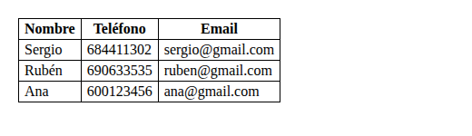
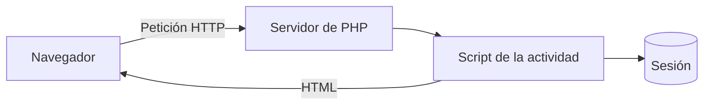

# Práctica 1: soluciones en PHP


Práctica formada por 6 ejercicios para una primera toma de contacto con *PHP*.
Aquí se resuelven todos, y el resto del documento sirve también como **ejemplo de Markdown**.




> Aprender a programar es ~~memorizar~~ practicar mucho.

Antes de empezar, un detalle importante:

> [!NOTE]
> Las actividades usan `match`, que necesita PHP 8.0 o superior. Por eso indicamos PHP 8.2.

## Contenido

- **Actividad 1:** muestra un mensaje de bienvenida con nombre, apellidos, edad y ciudad.
- **Actividad 2:** pide un número al usuario y muestra su tabla de multiplicar.
- **Actividad 3:** gestiona un array asociativo de alumnos, calcula la nota media
  y evalúa cada nota (Suspenso, Aprobado, Notable o Sobresaliente).
- **Actividad 4:** valida un formulario de registro (nombre, correo y edad) con mensajes de error.
- **Actividad 5:** usa sesiones y tiene tres partes:
  - Guarda el usuario al validar el formulario de la actividad 4.
  - Muestra una página de bienvenida personalizada.
  - Permite cerrar la sesión.
- **Actividad 6:** mini agenda de contactos. Se da de alta un contacto (nombre, teléfono y correo)
  con un formulario y se muestra el listado en una tabla HTML.

Los cambios de cada versión están en el archivo [CHANGELOG](CHANGELOG.md)[^1].

## Estructura del proyecto

```text
practica1/
├── actividad1/ ... actividad6/
├── images/
├── docs/
├── README.md
├── CHANGELOG.md
├── CONTRIBUTING.md
└── LICENSE
```

## Tecnologías

| Capa     | Tecnología | Versión |
|:---------|:----------:|--------:|
| Backend  |    PHP     |     8.2 |
| Frontend | HTML y CSS |       - |
| Docs     |  Markdown  |       - |

## Cómo funciona

El navegador envía el formulario al servidor interno de PHP, que ejecuta el script y devuelve la respuesta:



## Ejecución

Primero clona el repositorio y entra en la carpeta:

```bash
git clone https://github.com/USUARIO/practica1.git
cd practica1
```

### Actividades 1, 2 y 3 (terminal)

> [!WARNING]
> La actividad 2 usa `readline()`, así que **solo funciona desde la terminal**, no desde el navegador.

Se ejecutan directamente con PHP:

```bash
php actividad1/presentacion.php
```

Ejemplo en una línea: `php actividad3/alumnos.php`.

### Actividades 4, 5 y 6 (navegador)

1. Arranca el servidor interno de PHP (ojo, la `S` va en **mayúscula**):

   ```bash
   php -S localhost:8000
   ```

2. Abre el navegador y escribe la ruta del formulario:

   ```text
   http://localhost:8000/actividad6/formulario.html
   ```

Para parar el servidor:

> [!TIP]
> Pulsa `Ctrl+C` en la terminal donde lo has arrancado.

## Tareas pendientes

- [x] Hacer las 6 actividades
- [x] Escribir el README
- [x] Añadir CHANGELOG, CONTRIBUTING y LICENSE
- [ ] Guardar los contactos de la agenda (ahora se pierden al recargar)
- [ ] Mostrar una página de error si falta algún dato del formulario
- [ ] Subir el proyecto a un servidor de producción

## Preguntas frecuentes

<details>
<summary>¿Por qué da error `php -s`?</summary>

Porque la opción correcta es `-S` en mayúscula. Con la `s` minúscula PHP no arranca el servidor.

</details>

<details>
<summary>¿Por qué no funciona la actividad 2 en el navegador?</summary>

Porque usa `readline()`, que lee del teclado de la terminal. Hay que ejecutarla con `php actividad2/tabla.php`.

</details>

<details>
<summary>¿Por qué se pierden los contactos de la agenda?</summary>

Porque no se guardan en ningún sitio. El array se crea de nuevo cada vez que se carga la página.

</details>

## Licencia

Este proyecto se distribuye bajo la licencia **MIT**. Ver [LICENSE](LICENSE).

Elegimos MIT por tres motivos:

1. Es una licencia muy corta y fácil de entender.
2. Permite usar, copiar y modificar el código, algo ideal para una práctica de clase.
3. Solo pide mantener el aviso de copyright, sin obligar a publicar el código derivado.

Para saber cómo colaborar, lee [CONTRIBUTING](CONTRIBUTING.md).

## Autoría

Sergio Ruiz Ortiz - 2º DAW - IES Alixar

[^1]: Seguimos el formato [Keep a Changelog](https://keepachangelog.com/es-ES/1.1.0/) y el versionado semántico.
